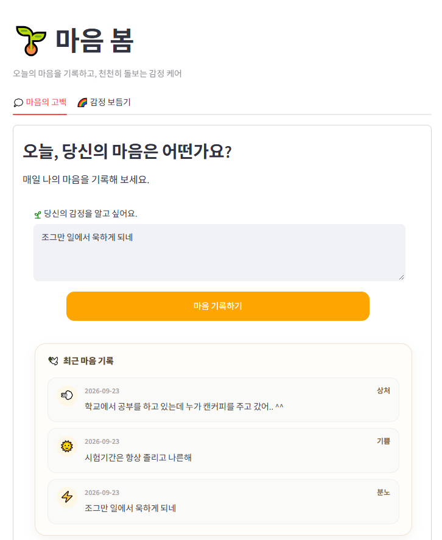

# 🌱 마음 봄 - AI 감정 기록 · 회고 웹앱

> 하루의 마음을 한 문장으로 기록하면, AI가 감정을 분류하고 따뜻한 회고 메시지를 건네주는 감정 케어 웹앱이다.



---

## 📌 프로젝트 개요

학업, 친구 관계, 진로, 가족 갈등 등으로 마음이 힘들어도 자신의 감정을 말로 꺼내거나 정확히 정리하기는 쉽지 않다. 고등학생 딸이 감정적으로 힘들어하는 모습을 보며 **"감정을 기록하고 스스로 돌아볼 수 있는 앱"** 의 필요성을 느껴 대학 과제로 prototype을 제작했다.

사용자가 오늘의 기분이나 있었던 일을 입력하면 **직접 학습한 LoRA 감정 분류 모델**이 감정을 분류해 Google Sheets에 저장하고, 최근 30일의 기록을 바탕으로 **OpenAI API**가 부드러운 회고 문장과 작은 실천 제안을 만들어 준다.

| 탭 | 설명 |
|---|---|
| 💭 **마음의 고백** | 오늘의 마음을 문장으로 기록하고, 최근 기록 5개를 날짜·감정·날씨 아이콘과 함께 확인 |
| 🌈 **감정 보듬기** | 최근 30일 감정 분포를 막대로 확인하고, AI가 작성한 공감 레터와 작은 실천 제안 확인 |

## 🎯 프로젝트 목표

- 감정을 **짧은 문장으로 가볍게 기록**하는 습관을 만들 수 있는 앱 제작
- **직접 Fine-tuning한 한국어 감정 분류 모델(LoRA)** 을 서비스에 적용해 보기 ( 생성형 AI 의 도움으로 해결 )
- 감정 분류(LoRA)와 문장 생성(GPT)의 **역할을 나눠** 안전하고 따뜻한 회고 메시지 제공
- 진단이 아닌 **스스로 돌아보도록 돕는 참고 정보**로서 결과 제시
- Streamlit 재실행 구조에서 **API 호출 횟수를 줄이는 설계**(캐시 · 세션 상태) 경험

## 🛠 사용 기술

| 구분     | 기술                                                                                                                                          |
| ------ | ------------------------------------------------------------------------------------------------------------------------------------------- |
| 언어 / 웹 | `Python` · `Streamlit` · `HTML·CSS`                                                                                                         |
| AI 모델  | `klue/roberta-base` · `LoRA (PEFT)` · `PyTorch` · `Transformers`                                                                            |
| 생성형 AI | `OpenAI API` (감정 요약 → 공감 레터 생성)                                                                                                             |
| 데이터    | `Pandas` · `Google Sheets` · `Google Apps Script` (doGet / doPost)                                                                          |
| 학습 데이터 | AI Hub [감성대화말뭉치](https://www.aihub.or.kr/aihubdata/data/view.do?currMenu=115&topMenu=100&aihubDataSe=data&dataSetSn=86) (Google Colab에서 학습) |

## ✨ 주요 기능

1. **마음 기록** - 입력한 문장과 날짜, 감정 분류 결과를 Google Sheets에 저장
2. **AI 감정 분류** - LoRA를 적용한 KLUE RoBERTa 모델이 60개 감정 중 확률이 가장 높은 감정을 예측
3. **최근 기록 조회** - 최근 5개의 기록을 감정별 날씨 아이콘과 함께 표시
4. **마음 기후 시각화** - 기쁨·당황·분노·불안·상처·슬픔 6가지 감정 분포를 백분율과 막대로 표시
5. **공감 메시지 생성** - 감정 분포와 가장 최근 기록을 바탕으로 제목 · 따뜻한 메시지 · 작은 실천 제안 제공

## 🔄 동작 흐름 (IPO)

```text
[INPUT]   오늘의 감정 문장 입력
   │
[PROCESS] ① LoRA 감정 분류 모델 → emotion1(대분류), emotion2(세부 감정) 분류
   │      ② Google Apps Script(doPost)로 Google Sheet에 저장
   │      ③ Google Apps Script(doGet)로 최근 30일 기록 조회 → 감정 비율 계산 (Pandas)
   │      ④ OpenAI API로 공감 레터 · 실천 제안 생성
   │
[OUTPUT]  감정 분류 결과 / 마음 상태 분포 / 공감 레터 / 작은 실천 제안
```

## ⭐ 주요 함수

| 함수 | 파일 | 역할 |
|---|---|---|
| **`predict_emotion(text, top_k)`** | `lib/emotion.py` | 문장을 토큰화해 LoRA 모델로 추론하고 확률 상위 `top_k`개 감정 반환 |
| **`save_emotion_log(txt, lora_data)`** | `lib/fun_lib.py` | 감정 분류 결과를 대분류/세부 감정으로 나눠 Apps Script(`doPost`)로 전송 |
| **`load_emotion_log()`** | `lib/fun_lib.py` | Apps Script(`doGet`)에서 최근 30일 기록을 조회 |
| **`generate_emotion_report_with_gpt(summary, recent_texts, N)`** | `lib/fun_lib.py` | 감정 요약과 최근 문장으로 공감 레터(JSON) 생성 |
| **`mind_text_list(df_list)`** / **`letter_box(str_json)`** | `lib/fun_lib.py` | 최근 기록 카드와 공감 레터 HTML 컴포넌트 생성 |
| **`load_emotion_log_cached()`** | `main.py` | `@st.cache_data(ttl=60)`로 시트 조회 결과를 60초간 재사용 |

## 💻 코드 스니펫

### 1. LoRA 감정 분류 ( AI 활용 ) — `predict_emotion()`

기반 모델 위에 학습된 LoRA 어댑터를 붙여 추론하고, 확률이 가장 높은 `top_k`개의 감정을 반환한다. 예측 라벨은 `기쁨_감사하는`처럼 **대분류_세부감정** 형태이다.

```python
# 기본 분류 모델 위에 학습된 LoRA adapter를 붙입니다.
base_model = AutoModelForSequenceClassification.from_pretrained(
    BASE_MODEL_NAME, num_labels=num_labels, id2label=id2label, label2id=label2id
)
model = PeftModel.from_pretrained(base_model, MODEL_DIR)
model.to(device)
model.eval()

def predict_emotion(text: str, top_k: int = 3):
    inputs = tokenizer(text, return_tensors="pt", truncation=True, max_length=128)
    inputs = {k: v.to(device) for k, v in inputs.items()}

    with torch.no_grad():
        outputs = model(**inputs)

    probs = torch.softmax(outputs.logits, dim=-1)[0]          # logits → 확률
    top_probs, top_indices = torch.topk(probs, k=top_k)       # 상위 k개 추출

    return [{"emotion": id2label[int(i)], "score": float(p)}
            for p, i in zip(top_probs, top_indices)]
```

### 2. Google Sheets 저장 — `save_emotion_log()`

Google Apps Script를 웹앱으로 배포해 Streamlit과 데이터를 주고받는다. `doPost(e)`는 시트에 데이터를 입력하고, `doGet(e)`는 최근 30일 데이터를 JSON으로 반환한다.

```python
def save_emotion_log(txt, lora_data, weather=""):
    url = st.secrets["google_sheet"]["app_script_url"]
    emotion_text = lora_data[0]["emotion"]          # 예: "슬픔_우울한"
    emotion1, emotion2 = emotion_text.split("_")    # 대분류 / 세부 감정 분리

    data = {
        "regist_dt": datetime.now().strftime("%Y-%m-%d"),
        "text": txt,
        "emotion1": emotion1,
        "emotion2": emotion2,
    }
    response = requests.post(url, json=data, timeout=10)
    return response.status_code == 200
```

### 3. OpenAI 공감 레터 — `generate_emotion_report_with_gpt()`

모델에는 **감정 요약과 가장 최근 문장**만 전달하였고, 프롬프트가 지켜야 할  안전 기준을 명시했다.

```python
response = client.responses.create(model="gpt-5-mini", input=prompt)
return response.output_text   # {"title", "message", "suggestion"} JSON
```

- 청소년 감정 기록 앱에 어울리게 **따뜻하고 다정하게** 작성
- 의학적 진단·치료·우울증 판정처럼 말하지 않기, **단정하지 않기**
- 숫자·퍼센트·기록 개수를 문장에 직접 쓰지 않기, 감정을 **좋고 나쁨으로 판단하지 않기**

```json
{
  "title": "짧은 제목",
  "message": "최근 감정 흐름에 대한 따뜻한 해석. 2문장 이내.",
  "suggestion": "오늘 바로 해볼 수 있는 작은 실천 제안. 1문장."
}
```

### 4. 캐시와 세션 상태로 API 호출 줄이기

Streamlit은 화면이 갱신될 때마다 코드를 처음부터 다시 실행하기 때문에, 그대로 두면 Google Sheet 조회와 GPT 호출이 반복된다. 그 부분은 `cache_data`와 `session_state`로 처리하였다.

```python
# 구글 시트 데이터를 60초 동안 캐시
@st.cache_data(ttl=60)
def load_emotion_log_cached():
    return fl.load_emotion_log()

# 새 마음을 기록하면 캐시를 비우고, GPT 리포트를 다시 만들도록 표시
success = fl.save_emotion_log(mind_text, em.predict_emotion(mind_text, top_k=1))
if success:
    st.cache_data.clear()                      # 시트에서 데이터를 다시 가져오도록
    st.session_state.init_report_done = False  # GPT 리포트 재생성

# 아직 리포트를 만들지 않았을 때만 GPT API 호출
if not st.session_state.init_report_done:
    data = fl.generate_emotion_report_with_gpt(summary, recent_text, 30)
    st.session_state.report = data
    st.session_state.init_report_done = True
```

### 5. 감정 분포 계산 · 시각화

저장된 기록을 집계한 후 6가지 감정의 비율을 구해 HTML/CSS 막대로 보여주었다.

```python
df_emotion = df.groupby("emotion1")["emotion2"].count()
max_emotion = df_emotion.idxmax()               # 가장 많이 나타난 감정

for key, item in fl.emotion.items():            # {"기쁨": "🌞", ...}
    cnt = df_emotion[key] if key in df_emotion.index else 0
    percent = int((cnt / total_cnt) * 100)
    # ... 감정 이름 + 퍼센트 + 막대(width:{percent}%) HTML 생성
st.markdown(str_html, unsafe_allow_html=True)   # Streamlit 안에 HTML 삽입
```

## 🧠 LoRA 모델 학습

**LoRA(Low-Rank Adaptation)** 는 기존 가중치는 고정(freeze)하고 옆에 붙인 작은 행렬(어댑터)만 학습하는 **PEFT(파라미터 효율적 미세조정)** 방법이다. 학습 대상 파라미터가 크게 줄어 Colab T4 같은 일반 GPU에서도 학습할 수 있었고, 결과 파일(`adapter_model.safetensors`)도 약 3.7MB로 작다.

| 항목      | 내용                                                                                     |
| ------- | -------------------------------------------------------------------------------------- |
| 기반 모델   | `klue/roberta-base`                                                                    |
| 학습 데이터  | AI Hub 감성대화말뭉치 51,630건 → 60개 레이블 (`대분류_세부감정`, 예: `기쁨_감사하는`)                            |
| 분류층     | `modules_to_save=classifier` — 마지막 분류층은 어댑터 없이 직접 학습                                   |
| 학습 환경   | Google Colab (GPT·Claude로 생성한 코드를 활용해 완성)                                              |

**데이터 정제**: 상담 대화 형태의 원본에서 **사용자(사람) 발화(최대 3턴)만 하나의 문장으로 합치고**, 감정 라벨을 `대분류_소분류` 하나로 합쳐 학습용 CSV로 만들었다. 

## 📁 폴더 구조

```text
01_project_mind/
├── .streamlit/
│   ├── config.toml      # 정적 파일 제공 기능 켜기
│   └── secrets.toml     # Google Apps Script URL, OpenAI API Key (※ 공개 저장소에 올리지 않기)
├── lora_model/          # LoRA 학습 결과 (adapter, tokenizer, label_map)
├── static/              # 감정 아이콘 SVG 파일
├── lib/
│   ├── emotion.py       # LoRA 모델 로드 및 감정 예측 함수
│   └── fun_lib.py       # Google Sheet 연동, GPT 리포트, HTML 컴포넌트 함수
└── main.py              # Streamlit 웹앱 시작 파일
```

## 🚀 실행 방법

```bash
conda create -n mind_env python=3.11
conda activate mind_env
pip install -r requirements.txt
streamlit run main.py
```

`.streamlit/secrets.toml`에 아래 값을 설정한다.

```toml
[openai]
api_key = "YOUR_OPENAI_API_KEY"

[google_sheet]
app_script_url = "YOUR_GOOGLE_APPS_SCRIPT_WEB_APP_URL"
```

## 🧗 어려웠던 점과 해결

| 문제                                                             | 해결                                                                |
| -------------------------------------------------------------- | ----------------------------------------------------------------- |
| 학습 데이터(약 5만 건)가 60개 레이블에 부족하고 하드웨어 사양도 한계가 있어 모델 정확도에 한계가 있었다. | 완벽한 분류보다 **스스로 돌아보도록 돕는 방향**으로 목표를 조정하여 결과를 진단이 아닌 "참고용"으로 제시하였다. |
| Streamlit 재실행으로 불필요한 API 호출 발생하였다.                             | `st.session_state`과 `st.cache_data`를 사용하여 불필요한 호출을 방지하였다.         |

## 📝 한계 및 향후 개선

- 감정 소분류 자체가 구분하기 미묘하고 데이터가 부족해 항상 정확하지 않다. 더 많은 데이터로 모델 성능 향상해 보고 싶다.
- 감정 털어내기 · 위로 받기 · 마음 돌보기 기능 등을 추가하고 싶다.
