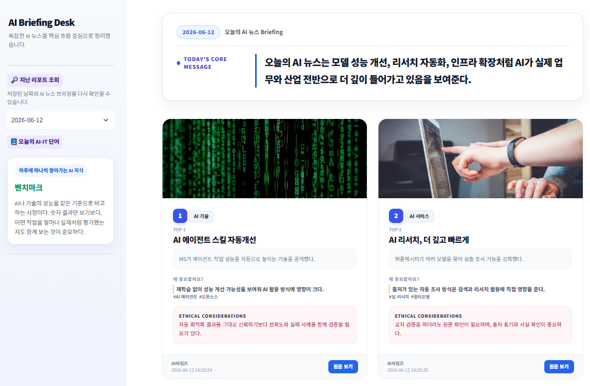

# 📰 오늘의 AI 뉴스 - AI 기반 뉴스 TOP 6 큐레이션 웹앱

> AI타임즈 RSS를 수집하고, 생성형 AI가 오늘 꼭 알아야 할 뉴스 TOP 6를 선정·요약·윤리 검토까지 해서 카드뉴스로 보여주는 Streamlit 웹앱 prototype


---

## 📌 프로젝트 개요

AI 뉴스는 매일 쏟아지지만, 여러 사이트를 직접 돌아다니며 중요한 뉴스를 고르고 흐름을 파악하기는 번거롭다. 특히 전문적으로 뉴스를 추적하지는 않지만 AI에 관심이 있는 사람에게는 **핵심 흐름을 빠르게 볼 수 있는 요약 도구**가 필요하다고 느꼈다.

이 프로젝트는 ChatGPT·Gemini·Canva AI를 활용한 **바이브코딩**으로 기획부터 코드, 디자인까지 진행했다. 처음 목표는 매일 오전 10시에 자동 수집하는 스케줄러였지만 구현 부담이 커서 제외하고, **접속했을 때 오늘 날짜의 뉴스 파일이 없으면 그때 1회 수집·생성하는 방식**으로 바꾸었다.

## 🎯 프로젝트 목표

- RSS 수집 → AI 선정·요약 → 카드뉴스 출력까지 **데이터가 흐르는 전체 파이프라인** 구현
- 프롬프트(페르소나 · 선정 기준 · 출력 JSON 형식)를 설계해 **일관된 구조화 데이터**를 받기
- 사실 확인 · 출처 · 편향 · 표현의 책임성 등 **AI 리터러시 관점의 윤리 기준**을 서비스에 반영
- 날짜별 JSON 저장으로 **API 호출을 최소화**하고 과거 뉴스도 다시 볼 수 있게 하기
- AI가 만든 코드를 그대로 쓰지 않고 **구조를 이해하고 선택해서 사용**하는 경험

## 🛠 사용 기술

| 구분     | 기술                                             |
| ------ | ---------------------------------------------- |
| 언어 / 웹 | `Python` · `Streamlit` · `HTML·CSS`            |
| 데이터 수집 | `feedparser` (AI타임즈 RSS)                       |
| 생성형 AI | `OpenAI API`                                   |
| 데이터 저장 | `JSON` (날짜별 파일) · `python-dotenv` (API 키 관리)   |
| 개발 도구  | ChatGPT · Gemini · Canva AI (기획 · 코드 · 디자인 시안) |

## ✨ 주요 기능

1. **RSS 뉴스 수집** - AI타임즈 RSS에서 최신 기사 20개의 제목·링크·요약·발행일 수집
2. **TOP 6 자동 선정** - 중요도·최신성·대중성·다양성·교육적 가치·신뢰성 기준으로 생성형 AI가 6개 선정
3. **카드뉴스 생성** - 한 줄 요약, 선정 이유, 키워드, 카테고리, 윤리적 고려사항을 JSON으로 구조화
4. **날짜별 저장 · 과거 뉴스 조회** - `data/YYYY-MM-DD.json`으로 저장하고 사이드바에서 과거 날짜를 골라 다시 보기
5. **카테고리별 이미지** - 11개 카테고리마다 이미지를 매칭해 카드에 표시
6. **오늘의 AI·IT 단어** - 뉴스와 관련된 용어 1개를 쉬운 설명과 함께 제공
7. **원문 링크 · 출처 표기** - 모든 카드에서 원문 기사로 이동해 사실 확인 가능

## 🔄 동작 흐름 (IPO)

```text
[INPUT]   웹앱 접속 (오늘 날짜 확인)
   │
[PROCESS] ① data/오늘날짜.json 이 있으면 그대로 로드
   │      ② 없으면 AI타임즈 RSS 수집 (feedparser, 최대 20개)
   │      ③ 생성형 AI API로 TOP 6 선정 + 요약 + 카테고리 + 윤리 메모 + 오늘의 단어 생성
   │      ④ 응답에서 JSON 외 문자(코드블록 등) 제거 후 data/ 폴더에 저장
   │         (생성에 실패하면 경고를 보여주고 저장된 날짜의 뉴스를 표시)
   │      ⑤ JSON을 읽어 HTML/CSS 카드뉴스로 렌더링
   │
[OUTPUT]  카드뉴스 TOP 6 / 오늘의 핵심 메시지 / 오늘의 단어 / 날짜별 과거 뉴스
```

## ⭐ 주요 함수

| 함수 | 파일 | 역할 |
|---|---|---|
| **`fetch_news_articles(max_count)`** | `lib/function_lib.py` | RSS에서 기사 제목·링크·요약·발행일을 리스트로 수집 |
| **`get_top_n_news_data(news_list, top_n)`** | `lib/function_lib.py` | 프롬프트를 만들어 OpenAI API로 TOP N 뉴스(JSON) 생성 |
| **`clean_json_text(response_text)`** | `lib/function_lib.py` | 코드블록·따옴표 등을 제거하고 순수 JSON만 추출 |
| **`save_selected_news_json()`** / **`load_selected_news_json()`** | `lib/function_lib.py` | 날짜별 JSON 저장 · 불러오기 (파일이 없거나 깨지면 `None`) |
| **`get_available_dates(DATA_DIR)`** | `lib/function_lib.py` | 저장된 날짜 목록 → 사이드바 날짜 선택 |
| **`render_cards(news_list)`** / **`render_card(news)`** | `templates/templates_card_news.py` | 카드뉴스 HTML 생성 (순위·카테고리 배지, 이미지, 키워드, 윤리 박스, 링크) |
| **`get_css()`** | `templates/templates_card_news.py` | CSS 전체를 문자열로 반환해 `<style>`로 삽입 |

## 💻 코드 스니펫

### 1. RSS 수집 — `fetch_news_articles()`

```python
def fetch_news_articles(max_count=20):
    RSS_URL = "https://www.aitimes.com/rss/allArticle.xml"
    feed = feedparser.parse(RSS_URL)

    news_list = []
    for entry in feed.entries[:max_count]:
        news_list.append({
            "title": entry.title,
            "link": entry.link,
            "summary": entry.summary,
            "published": entry.published,
        })
    return news_list
```

RSS는 제목·요약·링크·발행일이 구조화되어 있어 카드뉴스 데이터로 쓰기 좋았다.

### 2. TOP 6 선정 — `get_top_n_news_data()`

ChatGPT에게 포함할 요소를 알려주고 받은 프롬프트 초안을 다듬어 사용했다. 수집한 뉴스 목록을 JSON으로 프롬프트에 넣어 한 번에 호출한다.

```python
client = OpenAI(api_key=os.getenv("OPENAI_API_KEY"))

prompt = f"""너는 AI 뉴스 큐레이션 전문가이자 AI 리터러시 교육자이다.
... (페르소나 · 선정 기준 · 주의사항 · 카테고리 · 출력 JSON 형식)
[입력 뉴스 목록]
{json.dumps(news_list, ensure_ascii=False, indent=2)}"""

response = client.responses.create(model="gpt-5.4-mini", input=prompt)
return response.output_text
```

| 프롬프트 구성 | 내용 |
|---|---|
| 페르소나 | AI 뉴스 큐레이션 전문가 + AI 리터러시 교육자 |
| 선정 기준 | 중요도 · 최신성 · 대중성 · 다양성 · 교육적 가치 · 신뢰성 |
| 주의사항 | 목록에 없는 기사 생성 금지, 원문 추측 금지, 제목·링크는 입력값 그대로, 순수 JSON만 출력 |
| 카테고리 | AI 기술 · AI 서비스 · 기업·산업 · 정책·규제 · 교육·학습 · 연구·논문 · 보안·개인정보 · 윤리·사회 영향 · 콘텐츠·미디어 · 하드웨어·인프라 · 기타·종합 (11개) |
| 윤리 기준 | 정보 정확성, 출처와 저작권, 선정 편향 완화, 표현의 책임성, 오늘의 단어 기준 |

**출력 JSON 구조**

```json
{
  "selected_date": "YYYY-MM-DD",
  "selection_basis": "선정 기준 요약",
  "top_news": [
    {
      "rank": 1,
      "card_title": "카드뉴스용 짧은 제목",
      "one_line_summary": "한 줄 요약",
      "why_important": "왜 중요한지",
      "keywords": ["키워드1", "키워드2"],
      "source": "AI타임즈",
      "published": "발행일",
      "link": "원문 링크",
      "category": "AI 기술",
      "ethical_considerations": "윤리적 고려사항"
    }
  ],
  "today_core_message": "오늘의 AI 뉴스 흐름 한 문장",
  "today_word": "오늘의 단어",
  "today_description": "단어 설명 1~2문장"
}
```

### 3. 응답 JSON 정제 — `clean_json_text()`

AI 응답에 ` ```json ` 코드블록, 앞뒤 따옴표, 이스케이프 문자가 섞여 와서 파싱이 실패했다. 코드블록을 제거하고 **첫 `{`부터 마지막 `}`까지만** 잘라 저장한다.

```python
def clean_json_text(response_text: str) -> str:
    text = response_text.strip()

    # 응답 전체가 문자열로 감싸진 경우 한 번 풀어줌
    try:
        decoded = json.loads(text)
        if isinstance(decoded, str):
            text = decoded.strip()
    except json.JSONDecodeError:
        pass

    # 마크다운 코드블록 제거
    text = re.sub(r"^```json\s*", "", text, flags=re.IGNORECASE)
    text = re.sub(r"^```\s*", "", text)
    text = re.sub(r"\s*```$", "", text)

    # JSON 시작과 끝만 추출
    start, end = text.find("{"), text.rfind("}")
    if start == -1 or end == -1:
        raise ValueError("JSON 객체를 찾을 수 없습니다.")
    return text[start:end + 1]
```

### 4. 접속 시 1회 생성 · 실패 대비 — `app.py`

오늘 날짜의 JSON이 없을 때만 API를 호출하고, 실패해도 앱이 멈추지 않고 저장된 날짜의 뉴스를 보여준다.

```python
if search_today not in available_date:
    try:
        news_list = lb.fetch_news_articles(max_count=20)          # RSS 수집
        today_top_news_json = lb.get_top_n_news_data(news_list)   # AI로 TOP 6 선정
        lb.save_selected_news_json(today_top_news_json, f"data/{search_today}.json")
        available_date = lb.get_available_dates(DIR_PATH)
    except Exception as e:
        st.warning(f"오늘({search_today}) 뉴스 생성에 실패했습니다. 저장된 날짜의 뉴스를 보여드립니다.")

news_list = lb.load_selected_news_json(f"data/{search_today}.json")
if not news_list:
    st.error(f"{search_today} 뉴스 데이터를 불러오지 못했습니다.")
    st.stop()
```

### 5. 카드뉴스 렌더링 — `render_cards()`

Canvas AI가 만든 HTML 시안의 클래스명을 정리하고 CSS로 분리했다. `app.py`가 헤더 · 카드 · 푸터를 순서대로 출력하며, 카테고리 순서를 번호로 바꿔 `{번호}.jpg` 이미지를 카드에 매칭한다.

```python
title_html = tp.render_header(today_info)   # 오늘의 핵심 메시지 · 선정 기준
st.html(title_html)

card_html = tp.render_cards(news_list)      # render_card()를 반복 호출해 카드 6개 생성
st.html(card_html)
```

## 📁 폴더 구조

```text
02_project_ai_article/
├── .streamlit/
│   └── config.toml              # 정적 파일(이미지) 제공 기능 켜기
├── data/                        # 날짜별 TOP 6 뉴스 JSON (YYYY-MM-DD.json)
├── static/img/                  # 카테고리별 이미지 (1.jpg ~ 11.jpg)
├── lib/
│   └── function_lib.py          # RSS 수집, AI 호출, JSON 정제·저장·로드
├── templates/
│   └── templates_card_news.py   # CSS·카드뉴스 HTML 렌더링 함수
├── app.py                       # Streamlit 웹앱 시작 파일
├── requirements.txt
└── .env                         # API 키 (※ 공개 저장소에 올리지 않기)
```

## 🚀 실행 방법

```bash
conda create -n news_env python=3.11
conda activate news_env
pip install -r requirements.txt
streamlit run app.py
```

프로젝트 폴더에 `.env` 파일을 만들고 API 키를 설정한다.

```env
OPENAI_API_KEY=YOUR_OPENAI_API_KEY
```

> 오늘 날짜의 JSON이 `data/`에 없을 때만 API가 호출된다. 이미 있는 날짜는 파일만 읽어 보여준다.

## ⚖️ 사실 검증과 윤리적 고려

- **정확성**: 카드마다 원문 링크를 제공하고, 프롬프트에서 입력된 뉴스 외 내용을 추측하지 못하도록 제한
- **저작권·출처**: 원문을 그대로 복사하지 않고 짧게 재구성하며, 출처와 URL을 반드시 표기
- **편향성**: 선정 기준에 다양성과 긍정·우려 뉴스의 균형을 포함
- **표현의 책임성**: 공포감 조성, 낚시성 제목, 단정적인 전망을 피하도록 지시

## 💭 성찰 · 🔭 향후 계획

- 흐름은 단순해 보였지만 연결하자 고려할 점이 많았고, 특히 **Streamlit의 서버 이미지 출력**이 가장 마지막에 해결되었다.
- AI는 초안을 빠르게 주지만 코드가 길어질수록 불필요한 코드가 늘었다. **구조를 이해한 뒤 필요한 부분만 선택**해야 하고, 저작권·개인정보·코드 안정성은 직접 확인해야 했다.
- 향후: 뉴스 · 카테고리 · 키워드 검색 / 매일 가져오는 지식 저장 및 검색  /  스케줄러를 이용한 자동 수집
