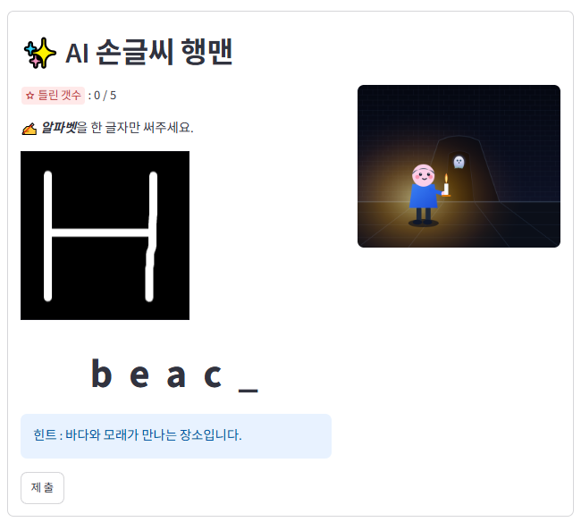

# ✍️ AI 손글씨 행맨 - 손으로 쓴 영어 단어 게임

> 캔버스에 알파벳을 손으로 쓰면 AI가 글자를 인식하고, 그 글자로 영어 단어를 맞히는 행맨 게임입니다.



---

## 📌 프로젝트 소개

영어 단어를 외울 때 키보드로 알파벳을 고르는 대신 **직접 손으로 글자를 쓰고, 그 글자를 AI가 읽어 주는** 행맨 게임을 만들었습니다. 영어 단어 학습에 손글씨 입력을 결합해, 게임을 즐기면서 AI의 이미지 인식 기능도 체험할 수 있도록 했습니다.

글자 인식 모델은 EMNIST(손글씨 알파벳·숫자 데이터셋)로 직접 학습한 CNN입니다. 중학생·고등학생 수준의 영어 단어 100개와 힌트를 준비했고, 오답 횟수에 따라 행맨 그림이 단계적으로 바뀝니다.

## ✨ 주요 기능

1. **손글씨 입력** - 캔버스에 마우스나 터치로 알파벳 한 글자를 작성
2. **AI 문자 인식** - 28×28 이미지로 변환해 CNN 모델이 알파벳을 예측 (확신도가 낮으면 다시 쓰도록 안내)
3. **단어 맞히기** - 힌트를 보고 글자를 제출하면 맞힌 글자가 단어에 표시
4. **진행 상황 표시** - 틀린 횟수(최대 5회)에 따라 행맨 이미지가 단계적으로 변경
5. **결과 안내** - 성공 또는 실패 메시지와 정답 단어·뜻을 표시
6. **새 게임** - 재시작하면 현재 난이도의 단어 중 하나를 무작위로 선택하고 진행 상태와 캔버스를 초기화

## 🔄 동작 흐름 (IPO)

```text
[INPUT]   캔버스에 손으로 쓴 알파벳 한 글자
   │
[PROCESS] ① 캔버스 이미지를 흑백으로 변환 → 글씨 영역을 잘라 정사각형으로 맞춤
   │      ② 28×28 리사이즈 (EMNIST 형식: 검은 배경 / 흰 글씨, 0~1 범위)
   │      ③ CNN 모델로 예측 → 알파벳 클래스 안에서 가장 높은 글자 선택
   │      ④ 확신도 확인 (낮으면 재입력 요청)
   │      ⑤ 정답 여부 판정 → 맞힌 글자 표시 / 틀린 횟수 증가
   │
[OUTPUT]  단어 진행 상황 / 틀린 횟수 / 행맨 이미지 / 성공·실패 메시지
```

## 🛠 사용 기술

`Python` · `Streamlit` · `streamlit-drawable-canvas` · `TensorFlow / Keras` · `NumPy` · `Pillow` · `EMNIST (tensorflow-datasets)`

## 📁 폴더 구조

```text
03_project_hangman/
├── lib/
│   ├── conf.py                       # 문제·모델 불러오기, 세션 관리, 이미지 전처리 함수
│   ├── hangman_words.json            # 단어 데이터 (난이도 1: 중학생 50개, 난이도 2: 고등학생 50개)
│   └── emnist_balanced_cnn_0811.keras  # 학습한 손글씨 인식 모델
├── static/img/                       # 행맨 단계별 이미지 (img_{난이도}{오답횟수}.png)
├── emnist.ipynb                      # 모델 학습 노트북
├── app.py                            # Streamlit 웹앱 시작 파일
└── requirements.txt
```

## 🚀 실행 방법

```bash
# 1. 가상환경 생성 및 활성화
conda create -n hangman_env python=3.11
conda activate hangman_env

# 2. 패키지 설치
pip install -r requirements.txt

# 3. 실행
streamlit run app.py
```

## 🧠 핵심 구현 설명

### 1. 손글씨 인식 모델 학습 — `emnist.ipynb`

| 항목 | 내용 |
|---|---|
| 데이터 | EMNIST balanced (47개 클래스: 숫자 10 + 알파벳 26 + 대소문자가 헷갈리는 소문자 11) |
| 데이터 크기 | 학습 112,800장 / 테스트 18,800장 |
| 모델 | Conv2D(32, 32, 64, 64, 128) + BatchNorm + Dropout + Dense(256) → softmax 47 (약 176만 파라미터) |
| 증강 | RandomRotation · RandomTranslation · RandomZoom |
| 학습 설정 | Adam, 최대 30 에포크, EarlyStopping · ReduceLROnPlateau · ModelCheckpoint |
| 결과 | 테스트 정확도 **85.96%** (EarlyStopping이 7 에포크에서 작동해 3 에포크 가중치로 복원) |

### 2. 이미지 전처리 - `preprocess_for_emnist()`

캔버스 이미지는 EMNIST와 모양이 달라서, 모델이 학습한 형태에 맞춰 변환합니다.

```text
① 배경이 밝으면 색 반전 (EMNIST는 검은 배경 + 흰 글씨)
② 노이즈 제거용 이진화
③ 글씨 영역(bounding box)만 잘라내기
④ 정사각형으로 패딩 (여백 20%, EMNIST 특유의 여백 재현)
⑤ 28×28로 리사이즈 → 0~1 범위로 변환
```

### 3. 알파벳만 선택 - `predict_char()`

모델은 숫자까지 47개 클래스를 출력하므로, 손글씨가 숫자(`1`, `2`, `5` 등)로 인식되면 게임에 쓸 수 없습니다. 숫자 클래스를 제외한 **알파벳 37개 클래스 안에서만** 가장 높은 확률을 고르고, 알파벳끼리 확률 합이 1이 되도록 다시 계산해 확신도(0.4 이상)를 판단합니다.

### 4. 입력 방향 보정 - `TRANSPOSE_INPUT`

학습 노트북이 EMNIST 이미지를 가로/세로 축을 바꿔(`tf.image.transpose`) 학습시켰기 때문에, 똑바로 쓴 글씨를 그대로 넣으면 인식이 되지 않았습니다. 그래서 `app.py`에서 모델 입력도 같은 방향으로 전치합니다. 모델을 방향 보정 없이 다시 학습하면 `TRANSPOSE_INPUT = False`로 바꿔야 합니다.

### 5. 게임 로직 - `submit_letter()`

- 이미 제출한 글자는 건너뛰어 오답이 중복으로 늘지 않습니다.
- 단어의 모든 글자가 맞은 글자에 포함되면 성공, 오답이 5회가 되면 실패로 종료합니다.
- 게임이 끝나면 제출 버튼을 비활성화합니다.
- Streamlit은 화면을 다시 실행하므로 `st.session_state`에 문제, 맞힌 글자, 오답 횟수, 종료 여부를 저장합니다.

## 🐞 오류 해결 기록

| 문제 | 원인 | 해결 |
|---|---|---|
| 거의 모든 글자가 잘못 인식됨 (예: `E` → `M`, 확신도 1.0) | 학습할 때는 이미지를 전치했는데 추론 입력은 똑바른 방향이라 서로 달랐음 | 디버그 화면에 모델 입력 28×28과 상위 후보를 표시해 확인한 뒤, 입력을 전치해서 해결 |
| 손글씨가 숫자로 인식됨 | 숫자 10개와 알파벳이 한 번에 비교됨 | 알파벳 클래스 안에서만 선택 |
| 새 글자를 쓰면 이전 글씨가 겹쳐 인식됨 | 캔버스가 제출 후에도 지워지지 않음 | 제출·재시작 때마다 캔버스 `key`를 바꿔 새 캔버스 생성 |
| 단어를 맞혀도 성공 처리가 안 됨 | 맞힌 글자를 이어 붙인 문자열과 정답을 비교해서 입력 순서가 같아야만 성공 | 단어의 모든 글자가 맞은 글자에 있는지로 판정 |
| 같은 틀린 글자를 반복하면 오답이 계속 증가 / 종료 후 제출하면 이미지 오류 | 중복 제출과 종료 후 제출을 막지 않음 | 이미 낸 글자 무시, 종료 후 제출 차단 (오답 5회에서 멈춤) |
| 리눅스 서버에서 행맨 이미지를 못 찾음 | 이미지 경로에 윈도우용 역슬래시(`\\`) 사용 | `Path` 객체로 경로 결합 |

## ⚠️ 한계

- 모델은 EMNIST(가는 획의 필기체)로 학습했고 캔버스는 마우스로 쓴 굵은 획이라, 글자를 작게 쓰거나 획이 겹치면 인식률이 떨어집니다.
- 비슷하게 생긴 글자(`b/h`, `n/h`, `u/v` 등)를 혼동하는 경우가 있습니다.
- 테스트 정확도(85.96%)는 EMNIST 데이터 기준이며, 실제 마우스 입력 정확도는 별도로 측정하지 않았습니다.

## 🔭 향후 계획

- **난이도 선택**: 단어 데이터(중학생 / 고등학생) 를 난이도에 맞게 출제
- **모델 개선**: 방향 변환 제거 후 재학습, 증강 중복 제거, `EarlyStopping` 기준을 `val_accuracy`로 변경, 굵은 획 증강, 직접 쓴 글씨로 미세조정
- **실사용 정확도 측정**: 글자별 인식 성공률을 표로 정리

---

