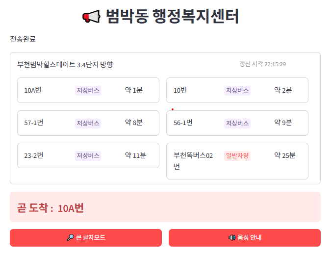

# 🚌 스마트 버스 정류소 안내 시스템

> 공공데이터(TAGO) 버스 도착 정보를 Streamlit 웹페이지로 보여 주고, 가장 먼저 도착하는 버스 2대를 아두이노 보드로 보내 LCD에 표시하는 버스 정류소 안내 프로젝트이다.



---

## 📌 프로젝트 개요

버스 정류소의 안내 화면은 글자가 작거나 정보가 한눈에 들어오지 않을 때가 있다. 이 프로젝트는 **TAGO 버스 도착 정보 API**에서 정류소의 실시간 도착 정보를 가져와 웹페이지로 보여 주고, 같은 정보를 **아두이노 보드에 연결한 LCD**에도 출력하는 prototype이다.

큰 글자 모드와 저상버스 구분 표시를 넣어 교통약자를 비롯한 다양한 이용자가 버스 정보를 쉽게 확인할 수 있도록 구성했다. 웹페이지는 30초마다 도착 정보를 새로 조회하고, 조회할 때마다 상위 2대의 정보를 아두이노로 전송한다.

| 구분 | 설명 |
|---|---|
| 🖥 **웹페이지 (Streamlit)** | 노선별 도착 예정 시간, 차량 유형, 도착 임박 버스, 큰 글자 모드 |
| 📟 **LCD (아두이노)** | 가장 먼저 도착하는 버스 2대의 노선번호 · 남은 시간(분) · 남은 정류장 수 |

## 🎯 프로젝트 목표

- 공공데이터 API의 **실시간 데이터를 가공**해 사용자가 보기 쉬운 화면으로 제공
- **소프트웨어(Streamlit)와 하드웨어(Arduino LCD)를 연결**하는 피지컬 컴퓨팅 경험
- 큰 글자 모드 · 저상버스 구분 등 **다양한 이용자를 배려한 정보 전달** 설계
- PC ↔ 아두이노 간 **JSON 시리얼 통신** 구조 설계와 구현

## 🛠 사용 기술

| 구분 | 기술 |
|---|---|
| 웹 | `Python` · `Streamlit` (`st.fragment`, `st.session_state`, `st.cache_resource`) |
| 데이터 | `Requests` · `Pandas` · `TAGO OpenAPI` (공공데이터포털) |
| 통신 | `PySerial` (USB 시리얼 9600bps) · `JSON` |
| 하드웨어 | `Arduino UNO R4 WiFi` · `I2C LCD 16×2` |
| 아두이노 (C++) | `ArduinoJson` · `LiquidCrystal_I2C` |

## ✨ 주요 기능

1. **실시간 도착 정보** - TAGO API에서 30초마다 조회해 노선별 도착 예정 시간과 차량 유형을 표시
2. **도착 임박 안내** - 도착까지 1분 이하로 남은 버스를 별도 영역에 강조
3. **큰 글자 모드** - 버튼으로 글자 크기와 화면 배치를 바꿔 정보를 크게 표시
4. **저상버스 구분** - 차량 유형(저상버스 · 일반버스 · 확인 불가)을 색상과 텍스트로 구분
5. **아두이노 LCD 출력** - 가장 먼저 도착하는 버스 2대를 JSON으로 전송해 LCD 두 줄에 표시
6. **오류 안내** - 아두이노 연결 실패, API 요청 오류, 버스 정보 없음 상황을 화면에 안내

## 🔄 동작 흐름 (IPO)

```text
[INPUT]   TAGO 버스 도착 정보 API (정류소 ID, 도시 코드)
   │
[PROCESS] ① 30초마다 API 요청 → JSON 응답을 DataFrame(Pandas)으로 변환
   │      ② 도착 시간 숫자 변환, 값이 없는 행 제거
   │      ③ 같은 노선의 여러 버스 중 가장 먼저 도착하는 차량만 선택, 도착 시간 순 정렬
   │      ④ 웹페이지: 노선 · 차량 유형 · 도착 예정(분) 카드 표시 / 1분 이하는 '곧 도착' 표시
   │      ⑤ 상위 2대(노선번호, 도착 시간, 남은 정류장 수)를 JSON으로 만들어 USB 시리얼로 전송
   │      ⑥ 아두이노: 줄바꿈까지 수신 → JSON 파싱 → 초를 분으로 올림 → LCD 출력
   │
[OUTPUT]  웹페이지 도착 정보 / LCD 2줄 안내
```

```text
[TAGO API] ──HTTP──▶ [Streamlit 앱 (PC)] ──USB 시리얼(9600bps)──▶ [아두이노 보드] ──I2C──▶ [LCD 16x2]
                          │
                          └──▶ 웹페이지 (브라우저)
```

## ⭐ 주요 함수

| 함수 | 파일 | 역할 |
|---|---|---|
| **`bus_list()`** `@st.fragment(run_every="30s")` | `app.py` | API 요청 → DataFrame 가공 → 카드 표시 → 아두이노 전송까지 30초마다 실행 |
| **`send_arduino(df)`** | `app.py` | 상위 2대를 JSON으로 만들어 시리얼로 전송 (`Lock`으로 동시 쓰기 방지) |
| **`connect_arduino()`** `@st.cache_resource` | `app.py` | 시리얼 연결을 한 번만 열어 재사용 (재실행 시 포트 충돌 방지) |
| **`btn_list()`** | `app.py` | 큰 글자 / 작은 글자 모드 전환 버튼 (`st.session_state["font_mode"]`) |
| **`parseBusList()`** | `.ino` | 수신한 JSON 배열을 파싱해 분 단위로 변환하고 LCD 두 줄에 출력 |
| **`loop()`** | `.ino` | 시리얼 수신 확인 → 줄바꿈까지 읽기 → LCD 갱신 |

## 💻 코드 스니펫

### 1. API 조회와 데이터 가공 — `bus_list()`

`@st.fragment(run_every="30s")`로 도착 정보 영역만 30초마다 다시 조회한다. 응답에 데이터가 **1개일 때는 리스트가 아닌 딕셔너리**로 오기 때문에 리스트로 감싸 DataFrame으로 만든다.

```python
@st.fragment(run_every="30s")
def bus_list():
    response = requests.get(st.secrets["TAGO"]["URL"], params=params, timeout=10)
    response.raise_for_status()
    ...
    item = result["body"]["items"].get("item")
    if isinstance(item, dict):       # 데이터가 1개인 경우
        item = [item]
    df = pd.DataFrame(item)

    df["arrtime"] = pd.to_numeric(df["arrtime"], errors="coerce")
    df = df.dropna(subset=["arrtime"]).reset_index(drop=True)

    # 같은 노선(routeno) 중 가장 먼저 도착하는 버스만 선택 → 도착 시간 순 정렬
    result = df.loc[df.groupby("routeno")["arrtime"].idxmin()] \
               .sort_values(by="arrtime").reset_index(drop=True)
```

### 2. 웹페이지 표시

| 항목 | 내용 |
|---|---|
| 도착 예정 | 초 단위 도착 시간을 `math.ceil(arrtime / 60)`으로 올림해 `약 N분` 표시 |
| 차량 유형 | 저상버스(보라) · 일반버스(파랑) · 확인 불가(노랑)로 구분 |
| 곧 도착 | 도착 시간이 60초 이하인 노선을 모아 강조 영역에 표시 |
| 글자 모드 | `st.session_state`로 작은 글자(2열 카드) / 큰 글자(한 줄 표) 전환 |

```python
if vehicle == "저상버스":
    color, bg_color, font_color = "violet", "#B27EFF", "#2A2145"
elif vehicle == "일반버스":
    color, bg_color, font_color = "blue", "#172D43", "#3D9DF3"

if arrtime <= 60:                     # 1분 이하 → '곧 도착'
    arrival_soon += str(buses['routeno']) + "번&nbsp;&nbsp;"
...
st.error(f"#### 곧 도착&nbsp;:&nbsp;&nbsp;{arrival_soon}")
```

### 3. 아두이노로 전송 — `connect_arduino()` · `send_arduino()`

Streamlit은 화면이 다시 실행되므로 `@st.cache_resource`로 연결을 한 번만 열어 재사용하고, `Lock`으로 동시에 쓰지 않게 한다. LCD가 한글을 표시하지 못해 노선명 `부천똑버스`는 `DDOK`으로 바꿔 보낸다.

```python
@st.cache_resource
def connect_arduino():
    connection = serial.Serial(port="COM3", baudrate=9600, timeout=1, write_timeout=1)
    time.sleep(2)                       # 보드가 재시작되는 시간
    connection.reset_input_buffer()
    return connection, Lock()

def send_arduino(df):
    arduino, serial_lock = connect_arduino()

    # TOP 2개만 전송
    bus_list = df[["routeno", "arrtime", "arrprevstationcnt"]].head(2)
    bus_list["routeno"] = bus_list["routeno"].replace("부천똑버스", "DDOK")

    msg = json.dumps(bus_list.to_dict(orient="records"), ensure_ascii=False) + "\n"
    with serial_lock:
        arduino.write(msg.encode("utf-8"))
```

전송되는 JSON 예시

```json
[{"routeno":"DDOK","arrtime":180,"arrprevstationcnt":2},
 {"routeno":"81","arrtime":420,"arrprevstationcnt":5}]
```

### 4. 아두이노 스케치 — `arduino_bus_station.ino`

줄바꿈(`\n`)까지 한 줄을 읽어 `ArduinoJson`으로 파싱하고, 초를 분으로 올려 LCD 한 줄(16자)에 출력한다.

```cpp
LiquidCrystal_I2C lcd = LiquidCrystal_I2C(0x27, 16, 2);

void parseBusList() {
  JsonDocument doc;
  DeserializationError error = deserializeJson(doc, bus_list);
  if (error) { Serial.println(error.c_str()); return; }   // 파싱 실패 시 오류 출력

  int i = 0;
  for (JsonObject bus : doc.as<JsonArray>()) {
    String routeno = bus["routeno"].as<String>();
    int minutes = (int)ceil(bus["arrtime"].as<int>() / 60.0);   // 초 → 분(올림)
    int stationcnt = bus["arrprevstationcnt"].as<int>();

    String line = "no." + routeno + " " + String(minutes) + "m " + String(stationcnt) + "st";
    lcd.setCursor(0, i++);
    lcd.print(line.substring(0, 16));        // 16자를 넘으면 잘라서 표시
  }
}

void loop() {
  if (Serial.available()) {
    bus_list = Serial.readStringUntil('\n');
    if (bus_list.length()) { lcd.clear(); parseBusList(); }
  }
  delay(500);
}
```

LCD 한 줄은 `no.{노선번호} {남은 분}m {남은 정류장 수}st` 형식이다.

```text
no.DDOK 3m 2st
no.81 7m 5st
```

## 🧰 준비물

| 구분 | 내용 |
|---|---|
| 보드 | Arduino UNO R4 WiFi |
| 표시 장치 | I2C 방식 LCD 16×2 (주소 `0x27`) |
| 연결 | USB 케이블 (PC ↔ 보드), LCD의 SDA·SCL·5V·GND를 보드에 연결 |
| 데이터 | 공공데이터포털 TAGO 버스 도착 정보 API 인증키, 도시 코드, 정류소 ID |

## 📁 폴더 구조

```text
04_project_bus_station/
├── .streamlit/
│   └── secrets.toml                  # TAGO API 키 · 도시 코드 · 정류소 ID · URL (※ 공개 저장소에 올리지 않기)
├── arduino_bus_station/
│   └── arduino_bus_station.ino       # 아두이노 스케치 (시리얼 수신 → JSON 파싱 → LCD 출력)
└── app.py                            # Streamlit 웹앱 시작 파일
```

## 🚀 실행 방법

### 1. 아두이노

1. Arduino IDE 라이브러리 관리자에서 **ArduinoJson**과 **LiquidCrystal I2C**를 설치한다.
2. LCD를 보드에 연결한다. I2C 주소는 스케치의 `LiquidCrystal_I2C(0x27,16,2)`와 같아야 한다.
3. 보드를 선택하고 `arduino_bus_station.ino`를 업로드한다.
4. **시리얼 모니터는 닫아 둔다.** 열려 있으면 Streamlit이 같은 포트를 열 수 없다.

### 2. Streamlit 앱

```bash
conda create -n bus_env python=3.11
conda activate bus_env
pip install streamlit requests pandas pyserial    # serial이 아니라 pyserial
streamlit run app.py
```

`.streamlit/secrets.toml`에 아래 값을 설정한다.

```toml
[TAGO]
API_KEY = "YOUR_TAGO_API_KEY"
CITY_CODE = "YOUR_CITY_CODE"
NODE_ID = "YOUR_STATION_NODE_ID"
URL = "TAGO_BUS_ARRIVAL_API_URL"
```

## 🔭 향후 계획

- 아두이노 R4 WiFi의 MQTT 데이터 전송 방식을 사용해 보고 싶다.
- 정류소 · 노선 선택 기능 · 음성 안내 기능을 추가해서 사용자 편의성을 높이고 싶다.
- 
